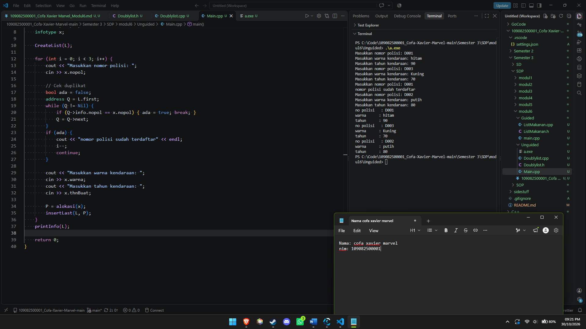
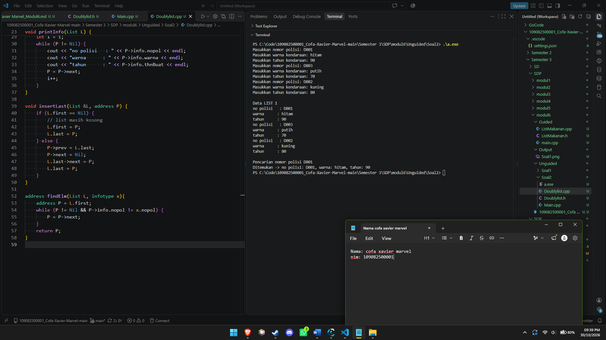
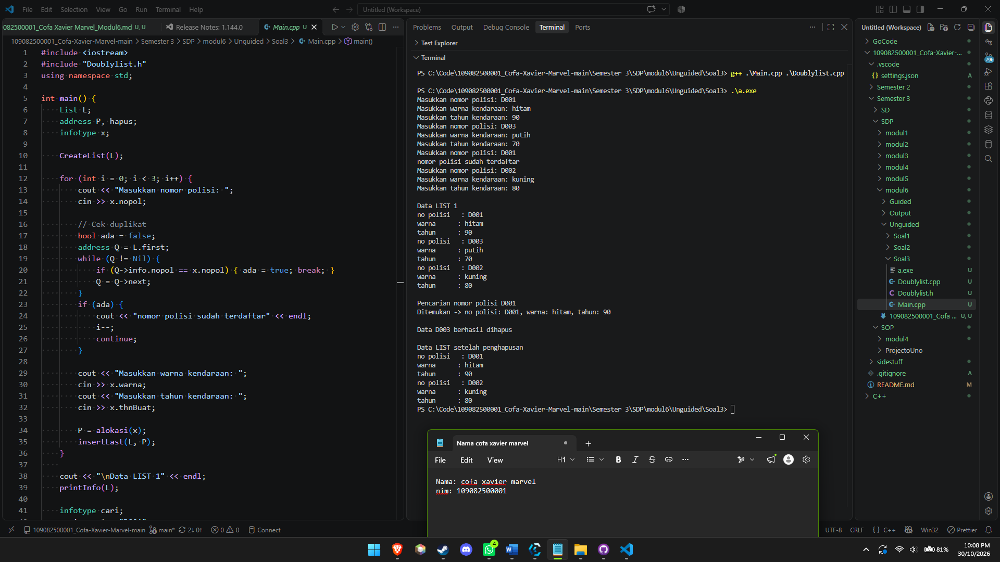

# <h1 align="center">Laporan Praktikum Modul 6 - DOUBLY LINKED LIST (BAGIAN PERTAMA)</h1>

<p align="center">Cofa Xavier Marvel - 109082500001</p>

## Dasar Teori
Daftar berantai ganda berarti daftar berantai yang menyimpan elemen berikutnya dan sebelumnya dalam daftar, biasanya ini digunakan untuk memutar kembali ke data sebelumnya untuk hal-hal seperti membatalkan, mengulang, dan riwayat situs.

## Guided

### 1. Header

```h
#ifndef LISTMAKANAN_H
#define LISTMAKANAN_H
#define Nil NULL

#include <iostream>
using namespace std;

struct makanan
{
    string nama;
    string jenis;
    float harga;
    float rating;
};

typedef makanan dataMakanan;

typedef struct node *address;

struct node
{
    dataMakanan isidata;
    address next;
    address prev;
};

struct linkedlist
{
    address first;
    address last;
};

bool isEmpty(linkedlist List);
void createList(linkedlist &List);
address alokasi(string nama, string jenis, float harga, float rating);
void dealokasi(address &node);

void insertFirst(linkedlist &List, address nodeBaru);
void insertLast(linkedlist &List, address nodeBaru);
void insertAfter(linkedlist &List, address nodeBaru, address Prev);
void insertBefore(linkedlist &List, address nodeBaru, address nodeNext);

void printList(linkedlist List);

void updateFirst(linkedlist List);
void updateLast(linkedlist List);
void updateAfter(linkedlist List, address prev);
void updateBefore(linkedlist List, address nodeNext);

// Searching
void findByName(linkedlist List, string nama);
void findByJenis(linkedlist List, string jenis);
void findByMinRating(linkedlist List, float minRating);

// Delete
void deleteFirst(linkedlist &List);
void deleteLast(linkedlist &List);
void deleteAfter(linkedlist &List, address Prev);
void deleteBefore(linkedlist &List, address nodeNext);

void deleteNode(linkedlist &List, address target);
void deleteByName(linkedlist &List, string nama);

#endif
```
Ini suatu file header untuk doubly linked list, dengan bedanya dalam structure list ada tambahan last, dan di structur node ada tamabahn prev. last tunjuk ke akhir list, dan prev tunjuk ke node ke arah first node.

### 2. Implentasi

```C++
#include "listMakanan.h"
#include <iostream>
#include <string>
using namespace std;

bool isEmpty(linkedlist List)
{
    return List.first == Nil
}

void createList(linkedlist &List)
{
    List.first = Nil;
    List.last = Nil;
}

// pembuatan node baru dengan menerapkan manajemen memori
address alokasi(string nama, string jenis, float harga, float rating)
{
    address nodeBaru = new node;
    nodeBaru->isidata.nama = nama;
    nodeBaru->isidata.jenis = jenis;
    nodeBaru->isidata.harga = harga;
    nodeBaru->isidata.rating = rating;
    nodeBaru->next = Nil;
    nodeBaru->prev = Nil;
    return nodeBaru;
}

void dealokasi(address &node)
{
    node->next = Nil;
    node->prev = Nil;
    delete node;
}

void insertFirst(linkedlist &List, address nodeBaru)
{
    if (isEmpty(List))
    {
        List.first = List.last = nodeBaru;
    }
    else
    {
        nodeBaru->next = List.first;
        List.first->prev = nodeBaru;
        List.first = nodeBaru;
    }
    cout << "Node " << nodeBaru->isidata.nama << " berhasil ditambahkan sebagai node pertama list" << endl;
}

void insertLast(linkedlist &List, address nodeBaru)
{
    if (isEmpty(List) == true)
    {
        List.last = List.first = nodeBaru;
    }
    else
    {
        nodeBaru->prev = List.last;
        List.last->next = nodeBaru;
        List.last = nodeBaru;
    }
    cout << "Node " << nodeBaru->isidata.nama << " berhasil ditambahkan sebagai node terakhir list" << endl;
}

void insertAfter(linkedlist &List, address nodeBaru, address nodePrev)
{
    if (isEmpty(List) == true)
    {
        List.first = List.last = nodeBaru;
    }
    else
    {
        if (nodePrev != Nil)
        {
            if (nodePrev == List.last)
            {
                insertLast(List, nodeBaru);
            }
            else
            {
                nodeBaru->next = nodePrev->next;
                nodeBaru->prev = nodePrev;
                (nodePrev->next)->prev = nodeBaru;
                nodePrev->next = nodeBaru;
                cout << "Node " << nodeBaru->isidata.nama << " berhasil ditambahkan setelah node " << nodePrev->isidata.nama << endl;
            }
        }
        else
        {
            cout << "node sebelumnya (nodePrev) tidak valid!" << endl;
        }
    }
}

void insertBefore(linkedlist &List, address nodeBaru, address nodeNext)
{
    if (isEmpty(List) == true)
    {
        List.first = List.last = nodeBaru;
    }
    else
    {
        if (nodeNext != Nil)
        {
            if (nodeNext == List.first)
            {
                insertFirst(List, nodeBaru);
            }
            else
            {
                nodeBaru->next = nodeNext;
                nodeBaru->prev = nodeNext->prev;
                (nodeNext->prev)->next = nodeBaru;
                nodeNext->prev = nodeBaru;
                cout << "Node " << nodeBaru->isidata.nama << " berhasil ditambahkan sebelum node " << nodeNext->isidata.nama << endl;
            }
        }
        else
        {
            cout << "node setelahnya (nodeNext) tidak valid!" << endl;
        }
    }
}

void printList(linkedlist List)
{
    if (isEmpty(List) == true)
    {
        cout << "List kosong!" << endl;
    }
    else
    {
        address nodeBantu = List.first;
        while (nodeBantu != Nil)
        {
            cout << "Nama makanan : " << nodeBantu->isidata.nama << endl;
            cout << "Jenis        : " << nodeBantu->isidata.jenis << endl;
            cout << "Harga        : " << nodeBantu->isidata.harga << endl;
            cout << "Rating       : " << nodeBantu->isidata.rating << endl;
            cout << "-------------------------------" << endl;
            nodeBantu = nodeBantu->next;
        }
    }
}

void updateFirst(linkedlist List)
{
    if (isEmpty(List) == true)
    {
        cout << "List kosong!" << endl;
    }
    else
    {
        cout << "Masukkan update data node pertama : " << endl;
        cout << "Nama makanan : ";
        getline(cin, List.first->isidata.nama);
        cout << "Jenis makanan : ";
        getline(cin, List.first->isidata.jenis);
        cout << "Harga : ";
        cin >> List.first->isidata.harga;
        cout << "Rating : ";
        cin >> List.first->isidata.rating;
        cin.ignore(); // menghapus karakter newline (/n) dari input buffer
        cout << "Data Berhasil Diupdate!" << endl;
        cout << endl;
    }
}

void updateLast(linkedlist List)
{
    if (isEmpty(List) == true)
    {
        cout << "List kosong!" << endl;
    }
    else
    {
        cout << "Masukkan update data node terakhir : " << endl;
        cout << "Nama makanan : ";
        getline(cin, List.last->isidata.nama);
        cout << "Jenis makanan : ";
        getline(cin, List.last->isidata.jenis);
        cout << "Harga : ";
        cin >> List.last->isidata.harga;
        cout << "Rating : ";
        cin >> List.last->isidata.rating;
        cin.ignore(); // menghapus karakter newline (/n) dari input buffer
        cout << "Data Berhasil Diupdate!" << endl;
        cout << endl;
    }
}

void updateAfter(linkedlist List, address nodePrev)
{
    if (isEmpty(List) == true)
    {
        cout << "List kosong!" << endl;
    }
    else
    {
        if (nodePrev != Nil && nodePrev->next != Nil)
        {
            address nodeBantu = nodePrev->next;
            cout << "masukkan update data node setelah node " << nodePrev->isidata.nama << " : " << endl;
            cout << "Nama makanan : ";
            getline(cin, nodeBantu->isidata.nama);
            cout << "Jenis makanan : ";
            getline(cin, nodeBantu->isidata.jenis);
            cout << "Harga : ";
            cin >> nodeBantu->isidata.harga;
            cout << "Rating : ";
            cin >> nodeBantu->isidata.rating;
            cin.ignore(); // menghapus karakter newline (/n) dari input buffer
            cout << "Data Berhasil Diupdate!" << endl;
            cout << endl;
        }
        else
        {
            cout << "Node sebelumnya (nodePrev) tidak valid!" << endl;
        }
    }
}

void updateBefore(linkedlist List, address nodeNext)
{
    if (isEmpty(List) == true)
    {
        cout << "List kosong!" << endl;
    }
    else
    {
        if (nodeNext != Nil && nodeNext->prev != Nil)
        {
            address nodeBantu = nodeNext->prev;
            cout << "masukkan update data node sebelum node " << nodeNext->isidata.nama << " : " << endl;
            cout << "Nama makanan : ";
            getline(cin, nodeBantu->isidata.nama);
            cout << "Jenis makanan : ";
            getline(cin, nodeBantu->isidata.jenis);
            cout << "Harga : ";
            cin >> nodeBantu->isidata.harga;
            cout << "Rating : ";
            cin >> nodeBantu->isidata.rating;
            cin.ignore(); // menghapus karakter newline (/n) dari input buffer
            cout << "Data Berhasil Diupdate!" << endl;
            cout << endl;
        }
        else
        {
            cout << "Node sebelumnya (prev) tidak valid!" << endl;
        }
    }
}

// SEARCHING
void findByName(linkedlist List, string nama)
{
    if (isEmpty(List))
    {
        cout << "List kosong!" << endl;
        return;
    }
    address p = List.first;
    while (p != Nil)
    {
        if (p->isidata.nama == nama)
        {
            cout << "Ditemukan (berdasarkan nama):" << endl;
            cout << "Nama makanan : " << p->isidata.nama << endl;
            cout << "Jenis        : " << p->isidata.jenis << endl;
            cout << "Harga        : " << p->isidata.harga << endl;
            cout << "Rating       : " << p->isidata.rating << endl;
            return;
        }
        p = p->next;
    }
    cout << "Data dengan nama \"" << nama << "\" tidak ditemukan." << endl;
}

void findByJenis(linkedlist List, string jenis)
{
    if (isEmpty(List))
    {
        cout << "List kosong!" << endl;
        return;
    }
    address p = List.first;
    while (p != Nil)
    {
        if (p->isidata.jenis == jenis)
        {
            cout << "Ditemukan (berdasarkan jenis):" << endl;
            cout << "Nama makanan : " << p->isidata.nama << endl;
            cout << "Jenis        : " << p->isidata.jenis << endl;
            cout << "Harga        : " << p->isidata.harga << endl;
            cout << "Rating       : " << p->isidata.rating << endl;
            return;
        }
        p = p->next;
    }
    cout << "Data dengan jenis \"" << jenis << "\" tidak ditemukan." << endl;
}

void findByMinRating(linkedlist List, float minRating)
{
    if (isEmpty(List))
    {
        cout << "List kosong!" << endl;
        return;
    }
    address p = List.first;
    while (p != Nil)
    {
        if (p->isidata.rating >= minRating)
        {
            cout << "Ditemukan (rating >= " << minRating << "):" << endl;
            cout << "Nama makanan : " << p->isidata.nama << endl;
            cout << "Jenis        : " << p->isidata.jenis << endl;
            cout << "Harga        : " << p->isidata.harga << endl;
            cout << "Rating       : " << p->isidata.rating << endl;
            return;
        }
        p = p->next;
    }
    cout << "Tidak ada data dengan rating >= " << minRating << "." << endl;
}

// DELETE
void deleteFirst(linkedlist &List)
{
    if (isEmpty(List) == true)
    {
        cout << "List kosong! Tidak ada node yang dihapus." << endl;
        return;
    }
    address pDel = List.first;
    if (List.last == List.first)
    {
        List.first = List.last = Nil;
    }
    else
    {
        List.first = pDel->next;
        List.first->prev = Nil;
        pDel->next = Nil;
    }
    pDel->prev = Nil;
    cout << "Node " << pDel->isidata.nama << " berhasil dihapus dari posisi pertama." << endl;
    dealokasi(pDel);
}

void deleteLast(linkedlist &List)
{
    if (isEmpty(List) == true)
    {
        cout << "List kosong! Tidak ada node yang dihapus." << endl;
        return;
    }
    address pDel = List.last;
    if (List.first == List.last)
    {
        List.first = List.last = Nil;
    }
    else
    {
        List.last = pDel->prev;
        List.last->next = Nil;
        pDel->prev = Nil;
    }
    pDel->next = Nil;
    cout << "Node " << pDel->isidata.nama << " berhasil dihapus dari posisi terakhir." << endl;
    dealokasi(pDel);
}

void deleteAfter(linkedlist &List, address Prev)
{
    if (isEmpty(List) == true)
    {
        cout << "List kosong! Tidak ada node yang dihapus." << endl;
        return;
    }
    if (Prev == Nil || Prev->next == Nil)
    {
        cout << "Node sebelumnya (Prev) tidak valid atau tidak ada node setelahnya!" << endl;
        return;
    }
    if (Prev->next == List.last)
    {
        deleteLast(List);
        return;
    }
    address pDel = Prev->next;
    Prev->next = pDel->next;
    pDel->next->prev = Prev;
    pDel->next = Nil;
    pDel->prev = Nil;
    cout << "Node " << pDel->isidata.nama << " berhasil dihapus setelah node " << Prev->isidata.nama << "." << endl;
    dealokasi(pDel);
}

void deleteBefore(linkedlist &List, address nodeNext)
{
    if (isEmpty(List) == true)
    {
        cout << "List kosong! Tidak ada node yang dihapus." << endl;
        return;
    }
    if (nodeNext == Nil || nodeNext->prev == Nil)
    {
        cout << "Node setelahnya (nodeNext) tidak valid atau tidak ada node sebelumnya!" << endl;
        return;
    }
    if (nodeNext->prev == List.first)
    {
        deleteFirst(List);
        return;
    }
    address pDel = nodeNext->prev;
    nodeNext->next = pDel->next;
    pDel->prev = nodeNext;
    pDel->prev = Nil;
    pDel->next = Nil;
    cout << "Node " << pDel->isidata.nama << " berhasil dihapus sebelum node " << nodeNext->isidata.nama << "." << endl;
    dealokasi(pDel);
}

void deleteNode(linkedlist &List, address target)
{
    if (isEmpty(List) == true || target == Nil)
    {
        cout << "Target tidak valid atau list kosong!" << endl;
        return;
    }
    if (target == List.first)
    {
        deleteFirst(List);
    }
    else if (target == List.last)
    {
        deleteLast(List);
    }
    else
    {
        address L = target->prev;
        address R = target->next;
        L->next = R;
        R->prev = L;
        target->next = Nil;
        target->prev = Nil;
        cout << "Node " << target->isidata.nama << " berhasil dihapus dari tengah list." << endl;
        dealokasi(target);
    }
}

void deleteByName(linkedlist &List, string nama)
{
    if (isEmpty(List))
    {
        cout << "List kosong! Tidak ada node yang dihapus." << endl;
        return;
    }

    address target = List.first;
    while (target != Nil && target->isidata.nama != nama)
    {
        target = target->next;
    }
    if (target == Nil)
    {
        cout << "Node dengan nama \"" << nama << "\" tidak ditemukan." << endl;
        return;
    }

    deleteNode(List, target);
    cout << "Node dengan nama \"" << nama << "\" telah dihapus dan didealokasi." << endl;
}
```
Implementasi ini untuk procedur yang akan merubah orde list(delete, update, dan insert) ada tamabahan untuk mengubah prev.

### 3. Main.cpp
```C++
#include "listMakanan.h"
#include <iostream>

using namespace std;

int main()
{
    linkedlist List;
    address nodeA, nodeB, nodeC, nodeD, nodeE = Nil;
    createList(List);

    dataMakanan dtMakanan;

    nodeA = alokasi("Nasi Rames", "Makanan Berat", 10000, 8.5);
    nodeB = alokasi("Ayam Geprek", "Makanan Berat", 13000, 9.0);
    nodeC = alokasi("Risol Mayo", "Makanan Ringan", 3500, 8.8);
    nodeD = alokasi("Mie Ayam", "Makanan Berat", 15000, 9.9);
    nodeE = alokasi("Donat", "Makanan Ringan", 2000, 7.7);

    insertFirst(List, nodeD);
    insertLast(List, nodeE);
    insertAfter(List, nodeA, nodeD);
    insertBefore(List, nodeC, nodeE);
    insertLast(List, nodeB);
    cout << endl;

    // D - A - C - E - B
    cout << "--- Isi List Setelah Insert ---" << endl;
    printList(List);
    cout << endl;

    updateFirst(List);
    updateLast(List);
    updateBefore(List, nodeC);
    updateAfter(List, nodeA);

    cout << "--- Isi List Setelah Update ---" << endl;
    printList(List);

    cout << endl;

    findByName(List, "Nasgor");
    findByMinRating(List, 9.0);

    deleteByName(List, "Nasgor");
    deleteFirst(List);
    deleteBefore(List, nodeE);

    cout << endl
         << "--- Isi List Setelah Delete ---" << endl;
    printList(List);

    return 0;
}
```
Main. Tidak banyak perubahan dari linked list tunggal, masih menggunakan jalur utama untuk input dan output.


## Unguided

### 1.a Doublylist.h

```h
#ifndef Doublylist_H
#define Doublylist_H

#include <iostream>
#include <string>

using namespace std;

#define Nil NULL

struct infotype {
    string nopol;
    string warna;
    int thnBuat;
};

typedef struct elmlist *address;

struct elmlist {
    infotype info;
    address next;
    address prev;
};

struct List {
    address first;
    address last;
};

void CreateList(List &L);
address alokasi(infotype x);
void dealokasi(address &P);
void printInfo(List L);
void insertLast(List &L, address P);

address findElm(List L, infotype x);
void deleteFirst(List &L, address &P);
void deleteLast(List &L, address &P);
void deleteAfter(address Prec, address &P);

#endif
```
Header. Tempat deklarasi funsi, procedure, dan strukture.

### 1.b Doublylist.cpp
```cpp
#include "Doublylist.h"

void CreateList(List &L) {
    L.first = Nil;
    L.last = Nil;
}

address alokasi(infotype x) {
    address P = new elmlist;
    if (P != Nil) {
        P->info = x;
        P->next = Nil;
        P->prev = Nil;
    }
    return P;
}

void dealokasi(address &P) {
    delete P;
    P = Nil;
}

void printInfo(List L) {
    if (L.first == Nil) {
        cout << "Data LIST kosong" << endl;
        return;
    }
    address P = L.first;
    int i = 1;
    while (P != Nil) {
        cout << "no polisi   : " << P->info.nopol << endl;
        cout << "warna      : " << P->info.warna << endl;
        cout << "tahun      : " << P->info.thnBuat << endl;
        P = P->next;
        i++;
    }
}

void insertLast(List &L, address P) {
    if (L.first == Nil) {
        // list masih kosong
        L.first = P;
        L.last = P;
    } else {
        P->prev = L.last;
        P->next = Nil;
        L.last->next = P;
        L.last = P;
    }
}

```
Implementasion.
Untuk create,alokasi, dan insert perlu di perhatikan last, dan prev, agar jalan.

### 1.c main.cpp
```cpp
#include <iostream>
#include "Doublylist.h"
using namespace std;

int main() {
    List L;
    address P, hapus;
    infotype x;

    CreateList(L);

    for (int i = 0; i < 3; i++) {
        cout << "Masukkan nomor polisi: ";
        cin >> x.nopol;

        bool ada = false;
        address Q = L.first;
        while (Q != Nil) {
            if (Q->info.nopol == x.nopol) { ada = true; break; }
            Q = Q->next;
        }
        if (ada) {
            cout << "nomor polisi sudah terdaftar" << endl;
            i--;
            continue;
        }

        cout << "Masukkan warna kendaraan: ";
        cin >> x.warna;
        cout << "Masukkan tahun kendaraan: ";
        cin >> x.thnBuat;

        P = alokasi(x);
        insertLast(L, P);
    }

    cout << "\nData LIST 1" << endl;
    printInfo(L);
    return 0;
}
```
Main. input nomor polisi, warna, dan tahun kendaraan empat kali, ketika nomor polisi yang sama diberikan secara bertahap dan ditanyakan lagi. Display info sesudah 3 entri valid.

##### Output :


### 2.findElm
```h
address findElm(List L, infotype x);
```
Tambahan ke Doublylist.h.
Untuk declerasi ini suatu fungsi yang balikan address dari suatu list(l) yang mempunyai nomor polisi yang sama dari infotype(x)

```cpp
address findElm(List L, infotype x) {
    address P = L.first;
    while (P != Nil && P->info.nopol != x.nopol) {
        P = P->next;
    }
    return P;
}
```
Tambahan implementasi ke Doublylist.cpp.
iterasi dari first ke last dan jika P sama dengan x.nompol(nomor polisi) maka berhenti dan balikan address itu.

```cpp
    infotype cari;
    cari.nopol = "D001";
    address hasil = findElm(L, cari);
    cout << "\nPencarian nomor polisi D001" << endl;
    if (hasil != Nil) {
        cout << "Ditemukan -> no polisi: " << hasil->info.nopol
             << ", warna: " << hasil->info.warna
             << ", tahun: " << hasil->info.thnBuat << endl;
    } else {
        cout << "Data tidak ditemukan" << endl;
    }
```

Tamabahan ke main.c.
menetapkan suatu var dengan tipe strukture infotype dengan nama "cari" dan inisilisasikan nomor polisi jadi "D001", menggunakan fungsi findElm dengan parameter l, dan cari untuk inisilisasi ke variable tipe address nama hasil. Jika hasil tak nil maka print nomor polisi, warna, dan tahun, selain itu print data tidak ditemukan.

##### Output :


### 3.Delet first,last, dan after
```h
void deleteFirst(List &L, address &P);
void deleteLast(List &L, address &P);
void deleteAfter(address Prec, address &P);
```
Tambahan ke Doublylist.h.
Untuk declerasi ini tiga procedure yang menghapus node akhir, pertama, atau node sesudah suatu address(Prec).

```cpp
void deleteFirst(List &L, address &P) {
    P = L.first;
    if (L.first == L.last) {
        L.first = Nil;
        L.last = Nil;
    } else {
        L.first = L.first->next;
        L.first->prev = Nil;
        P->next = Nil;
    }
    dealokasi(P);
}

void deleteLast(List &L, address &P) {
    P = L.last;
    if (L.first == L.last) {
        L.first = Nil;
        L.last = Nil;
    } else {
        L.last = L.last->prev;
        L.last->next = Nil;
        P->prev = Nil;
    }
    dealokasi(P);
}

void deleteAfter(address Prec, address &P) {
    if (Prec->next != Nil) {
        P = Prec->next;
        Prec->next = P->next;
        if (P->next != Nil)
            P->next->prev = Prec;
        P->prev = Nil;
        P->next = Nil;
        dealokasi(P);
    }
}
```
Tambahan implementasi ke Doublylist.cpp.
delete first.   Jika hanya satu node first next dan last prev menjadi nil,tidak tunjuk ke node itu, dan dealokasi node.
                Jika ada satu atau lebih node first tunjuk ke nextnya first(node sesudah node pertama), first next menjadi nil dan address P next menjadi nil.
delete last.    Jika hanya ada satu elemen, maka elemen pertama dan terakhir akan diatur ulang menjadi Nil.
                jika lebih dari satu pembaruan terakhir ke pendahulunya dan memutuskan tautan node terakhir yang lama. Kemudian membebaskan memori node yang dihapus melalui deallocasi(P).
delete after    Fungsi ini menghapus node tepat setelah Prec dengan cara melewatinya, menghubungkan Prec->next ke penerus node yang dihapus, dan mengarahkan prev-nya kembali ke Prec. Kemudian, fungsi ini memutus tautan node yang dihapus dan membebaskan memorinya melalui dealokasi(P), dan tidak melakukan apa pun jika tidak ada node setelah Prec.

```cpp
    infotype cari;
    cari.nopol = "D001";
    address hasil = findElm(L, cari);
    cout << "\nPencarian nomor polisi D001" << endl;
    if (hasil != Nil) {
        cout << "Ditemukan -> no polisi: " << hasil->info.nopol
             << ", warna: " << hasil->info.warna
             << ", tahun: " << hasil->info.thnBuat << endl;
    } else {
        cout << "Data tidak ditemukan" << endl;
    }
```
Tambahan ke main.cpp.
Kode ini mencari kendaraan dengan nomor plat "D001" dalam daftar tertaut dengan memanggil fungsi findElm. Jika kendaraan ditemukan, kode akan menampilkan nomor plat, warna, dan tahun pembuatan; jika tidak, kode akan menunjukkan bahwa data tidak ditemukan.
##### Output 




## Kesimpulan
Ini mendemonstrasikan sebuah doubly linked list lengkap dengan manajemen pointer yang tepat untuk next dan prev selama pembuatan, alokasi, dan penyisipan. Ini mencakup fungsi pencarian yang mengulang melalui daftar untuk menemukan plat nomor yang cocok dan operasi penghapusan (first, last, dan after) yang secara benar mempertahankan integritas daftar dengan memperbarui pointer yang berdekatan sebelum deallokasi. Program utama memvalidasi input pengguna dengan memeriksa plat nomor duplikat dan menampilkan informasi kendaraan setelah tiga entri valid ditambahkan.

## Referensi

[1] Triase. (2020). Diktat Edisi Revisi : STRUKTUR DATA. Medan: UNIVERSTAS ISLAM NEGERI SUMATERA UTARA MEDAN.
<br>[2] Indahyati, Uce., Rahmawati Yunianita. (2020). "BUKU AJAR ALGORITMA DAN PEMROGRAMAN DALAM BAHASA C++". Sidoarjo: Umsida Press. Diakses pada 10 Maret 2024 melalui https://doi.org/10.21070/2020/978-623-6833-67-4.
<br>...
