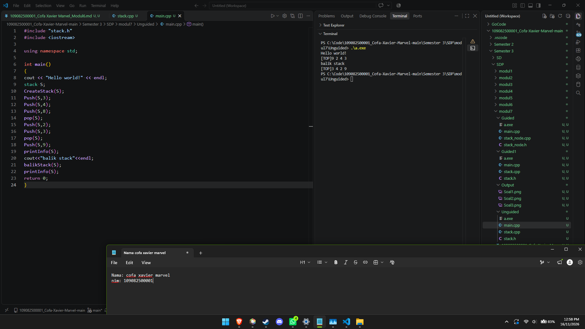
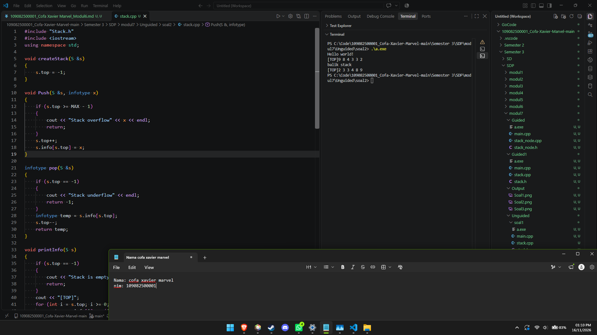
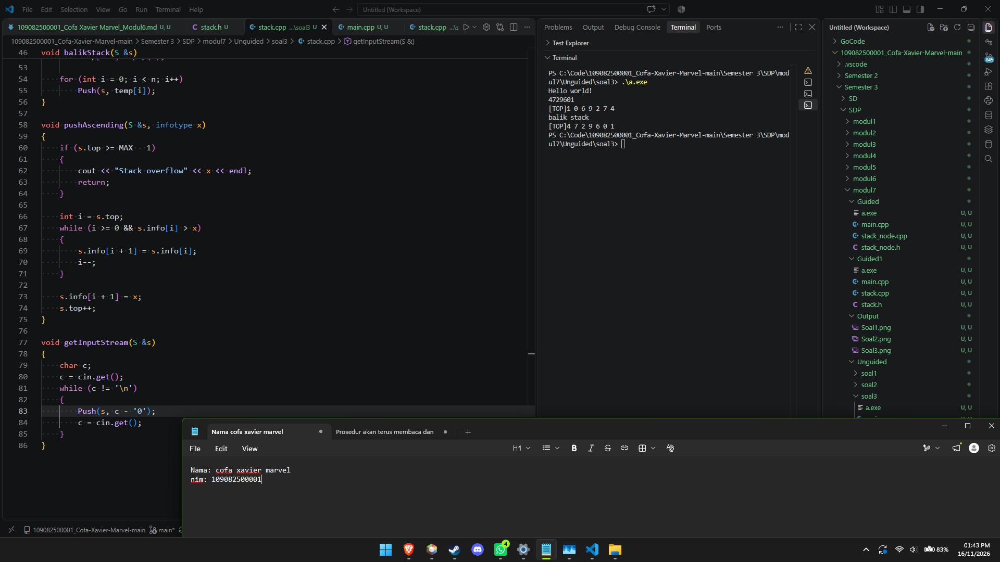

# <h1 align="center">Laporan Praktikum Modul 7 - Stack</h1>

<p align="center">Cofa Xavier Marvel - 109082500001</p>

## Dasar Teori
Stack adalah daftar elemen yang diurutkan berdasarkan masuk pertama keluar terakhir, artinya item pertama yang dimasukkan akan menjadi item terakhir yang dikeluarkan, dengan metode penyisipan mengikuti prinsip push, yaitu memasukkan ke bagian atas, dan pop, yaitu mengeluarkan elemen teratas.

## Guided

### 1. Header

```h
#ifndef STACK_TABLE
#define STACK_TABLE
using namespace std;
const int MAX = 10;

typedef struct stackTable
{
    int data[MAX];
    int top;
}S;

bool isEmpty(S s);
bool isFull(S s);
void createStack(S &s);
void push(S &s, int angka);
void pop(S &s);
void update(S &s, int posisi);
void view(S s);
void searchData(S s, int data);

#endif
```
Ini adalah header pertama yang kami buat, ini mewakili tumpukan terbatas menggunakan array.

```h
#ifndef STACK_NODE
#define STACK_NODE
using namespace std;

#define Nil NULL

typedef struct node *address;

struct node{
    int dataAngka;
    address next;
};

typedef struct stack
{
    address top;
}S;


bool isEmpty(S s);
void createStack(S &s);
address alokasi(int angka);
void alokasi(address &node);

void push(S &s, address newdata);
void pop(S &s);
void update(S &s, int posisi);
void view(S s);
void searchData(S s, int data);

#endif
```
Ini adalah contoh kedua yang merepresentasikan tumpukan kontinu menggunakan daftar berantai tunggal.

### 2. Implentasi

```C++
#include "stack.h"
#include <iostream>
using namespace std;

bool isEmpty(stackTable s)
{
    return s.top == -1;
}
bool isFull(stackTable s)
{
    return s.top == MAX - 1;
}
void createStack(stackTable &s)
{
    s.top = -1;
}
void push(stackTable &s, int angka)
{

    if (isFull(s))
    {
        cout << "Stack penuh!" << endl;
    }
    else
    {
        s.top++;
        s.data[s.top] = angka;
        cout << "Data" << angka << " berhasil ditambahkan kedalam stack !" << endl;
    }
}

void pop(stackTable &s)
{
    if (isEmpty(s))
    {
        cout << "Stack kosong!" << endl;
    }
    else
    {
        int val = s.data[s.top];
        s.top--;
        cout << "Data" << val << " berhasil dihapus dari stack!" << endl;
    }
}

void update(stackTable &s, int posisi)
{
    if (isEmpty(s))
    {
        cout << "Stack kosong!" << endl;
    }
    if (posisi <= 0)
    {
        cout << "Posisi tidak valid!" << endl;
        return;
    }
    // index = top

    int idx = s.top - (posisi - 1);
    if (idx < 0 || idx > s.top)
    {
        cout << "Posisi " << posisi << " tidak valid!" << endl;
        return;
    }

    cout << "Update data posisi ke-" << posisi << endl;
    cout << "Masukkan angka : ";
    cin >> s.data[idx];
    cout << "Data berhasil diupdate!" << endl;
    cout << endl;
}

void view(stackTable s)
{
    if (isEmpty(s))
    {
        cout << "Stack kosong!" << endl;
    }
    else
    {
        for (int i = s.top; i >= 0; --i)
        {
            cout << s.data[i] << " ";
        }
    }
    cout << endl;
}

void searchData(stackTable s, int data)
{
    if (isEmpty(s))
    {
        cout << "Stack kosong!" << endl;
        return;
    

    cout << "Mencari data " << data << "..." << endl;
    int posisi = 1;
    bool found = false;

    for (int i = s.top; i >= 0; --i)
    {
        if (s.data[i] == data)
        {
            cout << "Data " << data << " ditemukan pada posisi ke-" << posisi << endl;
            cout << endl;
            found = true;
            break;
        }
        posisi++;
    }

    if (!found)
    {
        cout << "Data " << data << " tidak ditemukan didalam stack!" << endl;
        cout << endl;
    }
}
}
```
Kode ini mengimplementasikan struktur data Stack dalam C++ menggunakan pendekatan berbasis array, yang didefinisikan oleh struct stackTable yang melacak indeks teratas dan bilangan bulat yang tersimpan. Kode ini mencakup isEmpty dan isFull untuk memeriksa keadaan stack, createStack untuk menginisialisasinya, push untuk menambahkan elemen ke bagian atas, dan pop untuk menghapus elemen teratas. Fungsi view menampilkan isi stack dalam urutan LIFO (Last-In, First-Out), berulang dari indeks teratas hingga nol.

```h
#include "stack_node.h"
#include <iostream>

using namespace std;

bool isEmpty(stack listStack)
{
    return (listStack.top == Nil)
}

void createStack(stack &listStack)
{
    listStack.top = Nil;
}

address alokasi(int angka)
{
    address nodeBaru = new node;
    nodeBaru->dataAngka = angka;
    nodeBaru->next = Nil;
    return nodeBaru;
}

void dealokasi(address &node)
{
    node->next = Nil;
    delete node;
}

void push(stack &listStack, address nodeBaru)
{
    nodeBaru->next = listStack.top;
    listStack.top = nodeBaru;
    cout << "Node " << nodeBaru->dataAngka << " berhasil ditambahkan kedalam stack!" << endl;
}

void pop(stack &listStack)
{
    address nodeHapus;
    if (isEmpty(listStack) == true)
    {
        cout << "Stack kosong!" << endl;
    }
    else
    {
        nodeHapus = listStack.top;
        listStack.top = listStack.top->next;
        nodeHapus->next = Nil;
        dealokasi(nodeHapus);
        cout << "node " << nodeHapus->dataAngka << " berhasil dihapus dari stack!" << endl;
    }
}

void update(stack &listStack, int posisi)
{
    if (isEmpty(listStack) == true)
    {
        cout << "Stack kosong!" << endl;
    }
    else
    {
        if (posisi == 0)
        {
            cout << "Posisi tidak valid!" << endl;
        }
        else
        {
            address nodeBantu = listStack.top;
            int count = 1;
            bool found = false;
            while (nodeBantu != Nil)
            {
                if (count < posisi)
                {
                    nodeBantu = nodeBantu->next;
                    count++;
                }
                else if (count == posisi)
                {
                    cout << "Update node poisisi ke-" << posisi << endl;
                    cout << "Masukkan angka : ";
                    cin >> nodeBantu->dataAngka;
                    cout << "Data berhasil diupdate!" << endl;
                    cout << endl;
                    found = true;
                    break;
                }
            }
            if (found == false)
            {
                cout << "Posisi " << posisi << " tidak valid!" << endl;
            }
        }
    }
}

void view(stack listStack)
{
    if (isEmpty(listStack) == true)
    {
        cout << "List kosong!" << endl;
    }
    else
    {
        address nodeBantu = listStack.top;
        while (nodeBantu != Nil)
        {
            cout << nodeBantu->dataAngka << " ";
            nodeBantu = nodeBantu->next;
        }
    }
    cout << endl;
}

void searchData(stack listStack, int data)
{
    if (isEmpty(listStack) == true)
    {
        cout << "List kosong!" << endl;
    }
    else
    {
        address nodeBantu = listStack.top;
        int posisi = 1;
        bool found = false;
        cout << "Mencari data " << data << "..." << endl;
        while (nodeBantu != Nil)
        {
            if (nodeBantu->dataAngka == data)
            {
                cout << "Data " << data << " ditemukan pada posisi ke-" << posisi << endl;
                found = true;
                cout << endl;
                break;
            }
            else
            {
                posisi++;
                nodeBantu = nodeBantu->next;
            }
        }
        if (found == false)
        {
            cout << "Data " << data << " tidak ditemukan didalam stack!" << endl;
            cout << endl;
        }
    }
}
```
Kode ini mengimplementasikan Stack linked-list, di mana elemen-elemen disimpan dalam node yang dialokasikan di heap, bukan dalam array tetap. Struktur stack hanya menyimpan pointer top, sehingga stack tumbuh dan menyusut saat runtime tanpa batasan ukuran atau pemeriksaan overflow. Operasi inti mencerminkan versi array: push menyisipkan node baru di depan dengan menghubungkan kembali pointer (nodeBaru->next = top; top = nodeBaru), dan pop melepaskan tautan node top, memajukan top, lalu menghapusnya sehingga memberikan perilaku LIFO sejati dengan insert/delete O(1).

### 3. Main.cpp
```C++
#include "stack.h"
#include <iostream>

using namespace std;

int main()
{
    stackTable s;
    createStack(s);

    push(s, 1);
    push(s, 2);
    push(s, 3);
    push(s, 4);
    push(s, 5);
    cout << endl;

    cout << "--- Stack setelah push ---" << endl;
    view(s);
    cout << endl;

    pop(s);
    pop(s);
    cout << endl;

    cout << "--- Stack setelah pop 2 kali ---" << endl;
    view(s);
    cout << endl;

    update(s, 2);
    update(s, 1);
    cout << endl;

    cout << "--- Stack setelah update ---" << endl;
    view(s);
    cout << endl;

    searchData(s, 4);
    searchData(s, 9);

    return 0;
}
```
Fungsi utama ini adalah ujian tumpukan berbasis array, yang mencerminkan versi linked-list tetapi menggunakan stackTable berukuran tetap. Fungsi ini menginisialisasi tumpukan dengan createStack, memasukkan nilai 1–5, kemudian melihat isinya dalam urutan LIFO: 5 4 3 2 1. Dua panggilan pop menghapus 5 dan 4, menyisakan 3 2 1.

Kemudian fungsi ini memanggil update pada posisi 2 dan 1. Posisi 2 dipetakan ke indeks array 1 dan posisi 1 dipetakan ke indeks 2, masing-masing meminta Anda untuk memasukkan nilai pengganti sebelum tampilan akhir menunjukkan tumpukan yang dimodifikasi. Terakhir, searchData mencari 4 dan 9, menunjukkan kedua hasil pencarian. Tidak seperti versi node, tidak ada panggilan posisi tidak valid keempat di sini, sehingga setiap pembaruan berhasil dalam batas yang ditentukan.
```C++
#include "stack_node.h"
#include <iostream>

using namespace std;

int main()
{
    stack listStack;
    address nodeA, nodeB, nodeC, nodeD, nodeE = Nil;
    createStack(listStack);

    nodeA = alokasi(1);
    nodeB = alokasi(2);
    nodeC = alokasi(3);
    nodeD = alokasi(4);
    nodeE = alokasi(5);

    push(listStack, nodeA);
    push(listStack, nodeB);
    push(listStack, nodeC);
    push(listStack, nodeD);
    push(listStack, nodeE);
    cout << endl;

    cout << "--- Stack setelah push ---" << endl;
    view(listStack);
    cout << endl;

    pop(listStack);
    pop(listStack);
    cout << endl;

    cout << "--- Stack setelah pop 2 kali ---" << endl;
    view(listStack);
    cout << endl;

    update(listStack, 2);
    update(listStack, 1);
    update(listStack, 4);
    cout << endl;

    cout << "--- Stack setelah update ---" << endl;
    view(listStack);
    cout << endl;

    searchData(listStack, 4);
    searchData(listStack, 9);

    return 0;
}
```
Fungsi utama ini adalah ujian yang menjalankan setiap operasi tumpukan linked-list. Ia membuat lima node yang menyimpan nilai 1–5, memasukkannya secara berurutan, mencetak hasilnya, kemudian mengeluarkan dua kali node 5 dan 4, dan melihat kembali untuk memastikan hanya 3, 2, dan 1 yang tersisa.

Selanjutnya, ia memanggil update pada posisi 2, 1, dan 4: dua posisi pertama berhasil, sedangkan posisi 4 gagal dengan pesan "Posisi tidak valid!" karena hanya ada tiga node. Terakhir, searchData mencari 4 dan 9, mendemonstrasikan jalur pencarian yang berhasil dan tidak berhasil sebelum keluar dengan bersih.

### 1. Buat “stack.h”, “stack.cpp” dan “main.cpp”:
```h
#ifndef STACK_H_INCLUDED
#define STACK_H_INCLUDED
using namespace std;
const int MAX = 20;
#define infotype int

typedef struct stack
{
    int info[MAX];
    int top;
}S;

void CreateStack(S &s);
void Push(S &s, infotype x);
infotype pop(S &s);
void printInfo(S s);
void balikStack(S &s);

#endif
```
Stack.h menggunakan array.

```C++
#include "Stack.h"
#include <iostream>
using namespace std;

void CreateStack(S &s)
{
    s.top = -1;
}

void Push(S &s, infotype x)
{
    if (s.top >= MAX - 1)
    {
        cout << "Stack overflow" << x << endl;
        return;
    }
    s.top++;
    s.info[s.top] = x;
}

infotype pop(S &s)
{
    if (s.top == -1)
    {
        cout << "Stack underflow" << endl;
        return -1;
    }
    infotype temp = s.info[s.top];
    s.top--;
    return temp;
}

void printInfo(S s)
{
    if (s.top == -1)
    {
        cout << "Stack is empty" << endl;
        return;
    }
    cout << "[TOP]";
    for (int i = s.top; i >= 0; i--)
        cout << s.info[i] << (i > 0 ? " " : "");
    cout << endl;
}

void balikStack(S &s)
{
    int temp[MAX];
    int n = 0;

    while (s.top != -1)
        temp[n++] = pop(s);

    for (int i = 0; i < n; i++)
        Push(s, temp[i]);
}
```
Implemintasi.

```C++
#include "stack.h"
#include <iostream>

using namespace std;

int main()
{
cout << "Hello world!" << endl;
stack S;
CreateStack(S);
Push(S,3);
Push(S,4);
Push(S,8);
pop(S);
Push(S,2);
Push(S,3);
pop(S);
Push(S,9);
printInfo(S);
cout<<"balik stack"<<endl;
balikStack(S);
printInfo(S);
return 0;
}
```
main.

####
##### Output :


### 2.pushAscending
```h
void pushAscending(S &s, infotype x);
```
Tambahan ke stack.h.
Fungsi ini menyisipkan elemen sehingga tumpukan tetap terurut dalam urutan menaik dari bawah ke atas, yang berarti elemen terbesar akan berada di bagian atas.

```cpp
void pushAscending(S &s, infotype x)
{
    if (s.top >= MAX - 1)
    {
        cout << "Stack overflow" << x << endl;
        return;
    }

    int i = s.top;
    while (i >= 0 && s.info[i] > x)
    {
        s.info[i + 1] = s.info[i];
        i--;
    }

    s.info[i + 1] = x;
    s.top++;
}
```
Tambahan implementasi ke stack.cpp.


```cpp
#include <iostream>
#include "Stack.h"
using namespace std;

int main()
{
    cout << "Hello world!" << endl;
    stack S;
    createStack(S);
    pushAscending(S, 3);
    pushAscending(S, 4);
    pushAscending(S, 8);
    pushAscending(S, 2);
    pushAscending(S, 3);
    pushAscending(S, 9);
    printInfo(S);
    cout << "balik stack" << endl;
    balikStack(S);
    printInfo(S);
    return 0;
}
```
Umbah main.c.
Buat tumpukan dan dorong angka 3, 4, 8, 2, 3, 9 secara berurutan, lalu cetak informasinya, kemudian balik tumpukan, lalu cetak lagi.

##### Output :


### 3.getInputStream
```h
void getInputStream(S &s);
```
Tambahan ke stack.h.
Untuk declerasi fungsi.

```cpp
void getInputStream(S &s)
{
    char c;
    c = cin.get();
    while (c != '\n')
    {
        Push(s, c - '0');
        c = cin.get();
    }
}
```


```cpp
#include <iostream>
#include "Stack.h"
using namespace std;

int main()
{
    cout << "Hello world!" << endl;
    stack S;
    createStack(S);
    getInputStream(S);
    printInfo(S);
    cout<<"balik stack"<<endl;
    balikStack(S);
    printInfo(S);
    return 0;
}
```
Tambahan ke main.cpp.
Prosedur akan terus membaca dan
menerima input user dan memasukkan setiap input ke dalam stack hingga user menekan
tombol enter.

##### Output 




## Kesimpulan
Program-program ini mendemonstrasikan bagian-bagian dari stack baik dalam penggunaan array maupun linked list ganda.

## Referensi

[1] Triase. (2020). Diktat Edisi Revisi : STRUKTUR DATA. Medan: UNIVERSTAS ISLAM NEGERI SUMATERA UTARA MEDAN.
<br>[2] Indahyati, Uce., Rahmawati Yunianita. (2020). "BUKU AJAR ALGORITMA DAN PEMROGRAMAN DALAM BAHASA C++". Sidoarjo: Umsida Press. Diakses pada 10 Maret 2024 melalui https://doi.org/10.21070/2020/978-623-6833-67-4.
<br>...
