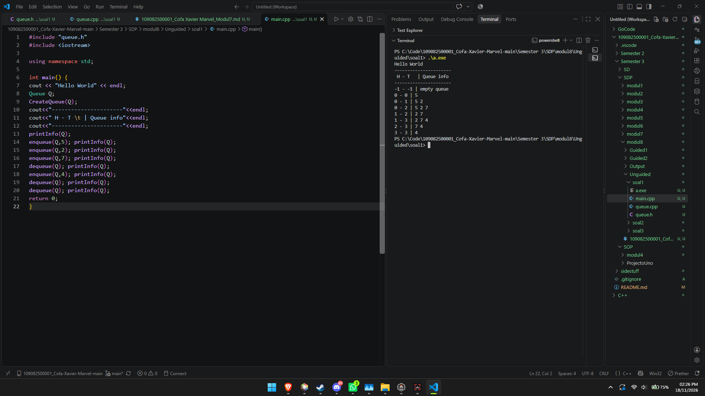
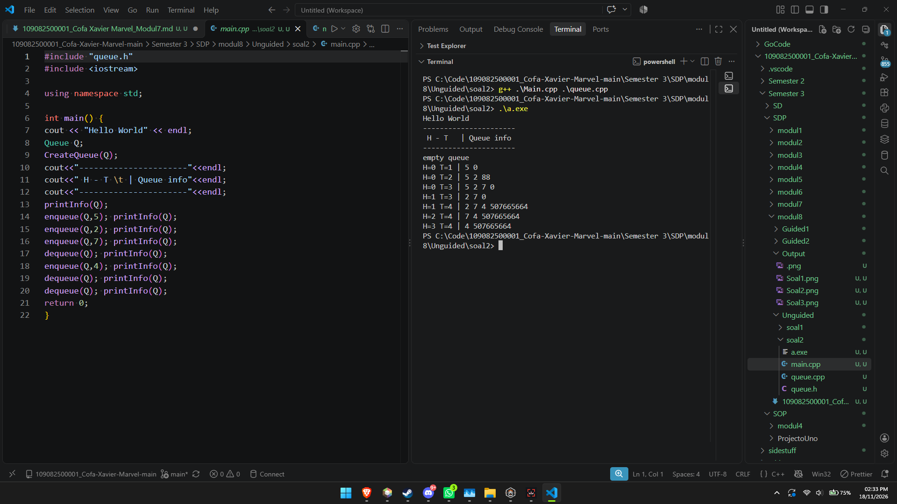
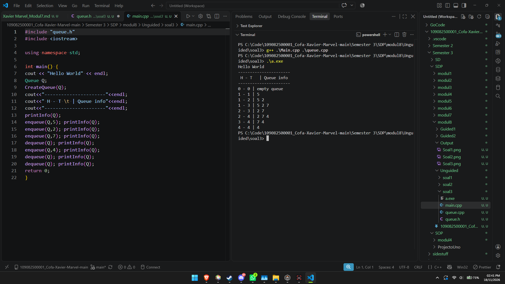

# <h1 align="center">Laporan Praktikum Modul 8 - Queue</h1>

<p align="center">Cofa Xavier Marvel - 109082500001</p>

## Dasar Teori
Queue adalah suatu ADT yang mempunyai aturan LIFO.

## Guided

### 1. Header

```h
#ifndef QUEUE_H
#define QUEUE_H
#include <iostream>
#include <string>

using namespace std;

typedef struct node *address;

struct node{
    string name;
    address next;
};

typedef struct Q
{
    address Head,Tail = nullptr;
}Q;


bool isFull(Q q);
bool isEmpty(Q q);
void createQueue(Q &q);
void enQueue(Q &q, const string &nama);
void deQueue(Q &q);
void viewQueue(Q q);
void clearQueue(Q &q);

#endif
```
Ini adalah header pertama yang kami buat, ini mewakili queue yang kontinous dengan mengunakan linked list.

```h
#ifndef QUEUE_ARRAY_H
#define QUEUE_ARRAY_H
#include <iostream>
using namespace std;

const int THEMAKS = 5; 

typedef 
struct queue
{
    string nama[THEMAKS];
    int head;
    int tail;
}
Q;


bool isFull(Q Q);
bool isEmpty(Q Q);
void createQueue(Q &Q);
void enQueue(Q &Q, const string &nama);
void deQueue(Q &Q);
void viewQueue(Q Q);
void clearQueue(Q &Q);

#endif
```
Ini adalah header kedua yang merepresentasikan queue terbatas menggunakan array.

### 2. Implentasi

```C++
#include "queue.h"

bool isFull(Q q){
    int count;
    address helperNode = q.Head;
    while (helperNode != nullptr)
    {
        count++;
        helperNode->next;
    }
    if (count == 20){
        return true;
    }
    return false;
}

bool isEmpty(Q q){
    return (q.Head == nullptr && q.Tail == nullptr);
}

void createQueue(Q &q){
    q.Head = q.Tail = nullptr;
}

void enQueue(Q &q, const string &nama){
    if (isEmpty(q)){
        address newNode = new node{nama,nullptr};
        q.Head = q.Tail = newNode;
    }else{
        address newNode = new node{nama,nullptr};
        q.Tail->next = newNode;
        q.Tail = newNode;
    }
}

void deQueue(Q &q){
    if (isEmpty(q)){
        cout << "ITS EMPTY YOU OIL BARREL";
    }else{
        address deleteNode = q.Head;
        cout <<"deleted name : "<< deletedNode->name << endl;
        q.Head = q.Head->next;
        delete deleteNode;
    }
}

void viewQueue(Q q){
    if (isEmpty(q)){
        cout << "ITS EMPTY YOU BILGE RAT";
    }else{
        address helperNode = q.Head;
        while (helperNode != nullptr)
        {
            cout <<"Name : "<< helperNode->name << endl;
        helperNode = helperNode->next;
        }
    }
}

void clearQueue(Q &q){
    if (isEmpty(q)){
        cout << "ITS EMPTY YOU OIL BARREL";
    }else{
    address deletedNode = q.Head;
    while (deletedNode != nullptr)
    {
        deletedNode = deletedNode->next;
        deQueue(q);
    }
    }
}
```
Kode ini mengimplementasikan struktur data queue dalam C++ menggunakan pendekatan berbasis singly linked list.

```h
#include "queue_array.h"
#include <iostream>

using namespace std;

// NOTE : 
// Implementasi 1 = head diam, tail bergerak (Queue Linear Statis, kerana head nya tetap diam)
// Implementasi 2 = head bergerak, tail bergerak (Queue Linear Dinamis, karena head & tail nya sama-sama bergerak)
// Implementasi 3 = head dan tail berputar (Queue Circular, karena jika udh mentok tapi masih ada space, diputar sehingga tail bisa ada didepan head)

bool isEmpty(q q){
    return (q.head == -1 && q.tail == -1)
}

//isFull implmenetasi 1 & 2
bool isFull(Q q){
    return (q.tail == MAKSIMAL - 1)
}

// //isFull implementasi 3
// bool isFull(Q q){
//     return ((q.tail + 1) % MAKSIMAL == q.head)

void CreateQueue(Q &q){ //terbentuk queue dengan head = -1 dan tail = -1 
    q.head = -1;
    q.tail = -1;
}
 

//enqueue implementasi 1 & 2
void enQueue(Q &q, string nama){
    if(isFull(q) == true){
        cout << "Queue sudah penuh!" << endl;
    } else {
        if(isEmpty(q) == true){
            q.head = q.tail = 0;
        } else {
            q.tail++;
        }
        q.nama[q.tail] = nama;
        cout << "nama " << nama << " berhasil ditambahkan kedalam queue!" << endl;
    }
}

// //enQueue implementasi 3
// void enQueue(queue &q, string nama){
//     if(isFull(q) == true){
//         cout << "Queue sudah penuh!" << endl;
//     } else {
//         if(isEmpty(q) == true){
//             q.head = q.tail = 0;
//         } else {
//             q.tail = (q.tail + 1) % MAKSIMAL; // bergerak melingkar
//         }
//         q.nama[q.tail] = nama;
//         cout << "nama " << nama << " berhasil ditambahkan kedalam queue!" << endl;
//     }
// }

//dequeue implementasi 1
void deQueue(Q &q){
    if(isEmpty(q) == true){
        cout << "Queue kosong!" << endl;
    } else {
        cout << "Mengahapus data " << q.nama[q.head] << "..." << endl;
        for(int i = 0; i < q.tail; i++){
            q.nama[i] =  q.nama[i+1];
        }
        q.tail--;
        if(q.tail < 0){ //kalo semua isi queue nya udh dikeluarin, set head & tail ke -1
            q.head = -1;
            q.tail = -1;
        }
    }
}

// //dequeue implementasi 2
// void deQueue(queue &q){
//     if(isEmpty(q) == true){
//         cout << "Queue kosong!" << endl;
//     } else {
//         cout << "Mengahapus data " << q.nama[q.head] << "..." << endl;
//         q.head++;
//         if(q.head > q.tail){ //kalo elemennya udh abis (head akan lebih 1 dari tail), maka reset ulang head & tail ke -1
//             q.head = -1;
//             q.tail = -1;
//         }
//     }
// }

// //deQueue implementasi 3
// void deQueue(queue &q){
//     if(isEmpty(q) == true){
//         cout << "Queue kosong!" << endl;
//     } else {
//         cout << "Mengahapus data " << q.nama[q.head] << "..." << endl;
//         if(q.head == q.tail){ //kalo elemennya tinggal 1, langsungkan saja head & tail nya reset ke -1
//             q.head = -1;
//             q.tail = -1;
//         } else {
//             q.head = (q.head + 1) % MAKSIMAL; // bergerak melingkar
//         }
//     }
// }

//viewQueue implementasi 1 & 2
void viewQueue(Q q){
    if(isEmpty(q) == true){
        cout << "Queue kosong!" << endl;
    } else {
        for(int i = q.head; i <= q.tail; i++){
            cout << i -  q.head + 1 << ". " << q.nama[i] << endl;
        }
    }
    cout << endl;
}

// //viewQueue implementasi 3
// void viewQueue(queue q){
//     if(isEmpty(q) == true){
//         cout << "Queue kosong!" << endl;
//     } else {
//         int i = q.head;
//         int count = 1;
//         while(true){
//             cout << count << ". " << q.nama[i] << endl;
//             if(i == q.tail){
//                 break;
//             }
//             i = (i + 1) % MAKSIMAL;
//             count++;
//         }   
//     }
// }
```
Kode ini mengimplementasikan array dengan beberapa alternatif dengan cara queue di simpan dalam array alt 1 head di 0 dan tidak maju, alt 2 head bergerak ke tail jika dequeue, dan alt 3 mana head dan tail itu berputar, mengelilingi indeks tabel dari awal sampai akhir, kemudian kembali ke awal. 

### 3. Main.cpp
```C++
#include "queue.h"
#include <iostream>
using namespace std;

int main()
{
    cout << "---- Queue Demo Begins  ----" << endl;
    Q Q;
    createQueue(Q);

    cout << "---- enQueue Begins  ----" << endl;
    enQueue(Q, "Gilran");
    enQueue(Q, "Alfa");
    enQueue(Q, "Ideal");
    enQueue(Q, "Father");
    enQueue(Q, "Kevin, THE GREAT AND MIGHTY WIZARD");
    enQueue(Q, "Zabumafu");
    cout << endl;
    cout << "---- enQueue done  ----" << endl;
    viewQueue(Q);

    cout << "---- deQueue Begins  ----" << endl;
    deQueue(Q);
    deQueue(Q);
    deQueue(Q);
    cout << "---- deQueue done  ----" << endl;
    viewQueue(Q);

    cout << "---- clearQueue Begins  ----" << endl;
    clearQueue(Q);
    cout << "---- clearQueue done  ----" << endl;
    viewQueue(Q);

    return 0;
}
```

```C++
#include "queue_array.h"
#include <iostream>

using namespace std;

int main(){
    queue Q;

    CreateQueue(Q);
    enQueue(Q, "Dimas");
    enQueue(Q, "Arvin");
    enQueue(Q, "Rizal");
    enQueue(Q, "Hafizh");
    enQueue(Q, "Fathur");
    enQueue(Q, "Daffa");
    cout << endl;

    cout << "--- Isi Queue Setelah enQueue ---" << endl;
    viewQueue(Q);
    cout << endl;

    deQueue(Q);
    deQueue(Q);
    deQueue(Q);
    deQueue(Q);
    // deQueue(Q);
    // deQueue(Q);
    cout << endl;

    cout << "--- Isi Queue Setelah deQueue ---" << endl;
    viewQueue(Q);

    return 0;
}
```


### 1. Buat “queue.h”, “queue.cpp” dan “main.cpp” alt1:
```h
#ifndef QUEUE_H
#define QUEUE_H

typedef int infotype;

struct Queue {
    infotype info[5];
    int head, tail;
};

void CreateQueue(Queue &Q);
bool isEmptyQueue(Queue Q);
bool isFullQueue(Queue Q);
void enqueue(Queue &Q, infotype x);
infotype dequeue(Queue &Q);
void printInfo(Queue Q);

#endif
```
Stack.h menggunakan array.

```C++
#include <iostream>
using namespace std;
#include "queue.h"

#define MaxEl 5

void CreateQueue(Queue &Q) {
    Q.head = -1;
    Q.tail = -1;
}

bool isEmptyQueue(Queue Q) {
    return (Q.head == -1 && Q.tail == -1);
}

bool isFullQueue(Queue Q) {
    return (Q.tail == MaxEl - 1);
}

void enqueue(Queue &Q, infotype x) {
    if (!isFullQueue(Q)) {
        if (isEmptyQueue(Q)) {
            Q.head = 0;   // elemen pertama -> head ikut ke 0
        }
        Q.tail++;
        Q.info[Q.tail] = x;
    } else {
        cout << "Queue sudah penuh!" << endl;
    }
}

infotype dequeue(Queue &Q) {
    infotype x;
    if (!isEmptyQueue(Q)) {
        x = Q.info[Q.head];
        if (Q.head == Q.tail) {
            Q.head = -1;  // elemen terakhir diambil
            Q.tail = -1;
        } else {
            Q.head++;     // head bergerak saat dequeue
        }
        return x;
    } else {
        cout << "Queue kosong!" << endl;
        return -9999; // sentinel, sesuaikan jika perlu
    }
}

void printInfo(Queue Q) {
    cout << Q.head << " - " << Q.tail << " | ";
    if (isEmptyQueue(Q)) {
        cout << "empty queue";
    } else {
        for (int i = Q.head; i <= Q.tail; i++) {
            cout << Q.info[i] << " ";
        }
    }
    cout << endl;
}
```
Implemintasi.

```C++

```
main.

####
##### Output :


### 2.alt2
```cpp
#include <iostream>
using namespace std;
#include "queue.h"

#define MaxEl 5

void CreateQueue(Queue &Q) {
    Q.head = 0;
    Q.tail = 0;
}

bool isEmptyQueue(Queue Q) {
    return (Q.head == Q.tail);
}

bool isFullQueue(Queue Q) {
    return (Q.head == 0 && Q.tail == MaxEl - 1);
}

void enqueue(Queue &Q, infotype x) {
    if (isFullQueue(Q)) {
        cout << "Queue Penuh! (Overflow)" << endl;
        return;
    }
    
    Q.info[Q.tail] = x;
    
    if (Q.tail == MaxEl - 1) {
        Q.tail = 0;
    } else {
        Q.tail++;
    }
}

infotype dequeue(Queue &Q) {
    if (isEmptyQueue(Q)) {
        cout << "Queue Kosong! (Underflow)" << endl;
        return -9999;
    }

    infotype x = Q.info[Q.head];
    
    if (Q.head == MaxEl - 1) {
        Q.head = 0;
    } else {
        Q.head++;
    }

    return x;
}

void printInfo(Queue Q) {
    if (isEmptyQueue(Q)) {
        cout << "empty queue" << endl;
        return;
    }

    cout << "H=" << Q.head << " T=" << Q.tail << " | ";
    int i = Q.head;
    while (true) {
        cout << Q.info[i] << " ";
        if (i == Q.tail) break;
        
        if (i == MaxEl - 1) {
            i = 0;
        } else {
            i++;
        }
    }
    cout << endl;
}
```
Ubah queue.cpp menjadi ini.

##### Output :


### 3.alt3
```h
#ifndef QUEUE_H
#define QUEUE_H

typedef int infotype;

struct Queue {
    infotype info[6];
    int head, tail;
};

void CreateQueue(Queue &Q);
bool isEmptyQueue(Queue Q);
bool isFullQueue(Queue Q);
void enqueue(Queue &Q, infotype x);
infotype dequeue(Queue &Q);
void printInfo(Queue Q);

#endif
```
ubah info menjadi panjang 6 membuang index 0.

```cpp
#include <iostream>
using namespace std;
#include "queue.h"

const int IdxMax = 5;

int succ(int i) {
    if (i == IdxMax) {
        return 1;
    }else{
        return i + 1;
    }
}

void CreateQueue(Queue &Q) {
    Q.head = 0;
    Q.tail = 0;
}

bool isEmptyQueue(Queue Q) {
    return (Q.head == 0 && Q.tail == 0);
}

bool isFullQueue(Queue Q) {
    return (succ(Q.tail) == Q.head);
}

void enqueue(Queue &Q, infotype x) {
    if (isFullQueue(Q)) {
        cout << "Queue sudah penuh!" << endl;
        return;
    }
    if (isEmptyQueue(Q)) {
        Q.head = 1;
        Q.tail = 1;
    } else {
        Q.tail = succ(Q.tail);
    }
    Q.info[Q.tail] = x;
}

infotype dequeue(Queue &Q) {
    infotype x;
    if (isEmptyQueue(Q)) {
        cout << "Queue kosong!" << endl;
        return -9999;
    }
    x = Q.info[Q.head];
    if (Q.head == Q.tail) {
        Q.head = 0;
        Q.tail = 0;
    } else {
        Q.head = succ(Q.head);
    }
    return x;
}

void printInfo(Queue Q) {
    cout << Q.head << " - " << Q.tail << " | ";
    if (isEmptyQueue(Q)) {
        cout << "empty queue" << endl;
        return;
    }
    int i = Q.head;
    while (true) {
        cout << Q.info[i] << " ";
        if (i == Q.tail) break;
        i = succ(i);
    }
    cout << endl;
}
```
Implementasi

##### Output 




## Kesimpulan
Program-program ini mendemonstrasikan bagian-bagian dari stack baik dalam penggunaan array maupun linked list ganda.

## Referensi

[1] Triase. (2020). Diktat Edisi Revisi : STRUKTUR DATA. Medan: UNIVERSTAS ISLAM NEGERI SUMATERA UTARA MEDAN.
<br>[2] Indahyati, Uce., Rahmawati Yunianita. (2020). "BUKU AJAR ALGORITMA DAN PEMROGRAMAN DALAM BAHASA C++". Sidoarjo: Umsida Press. Diakses pada 10 Maret 2024 melalui https://doi.org/10.21070/2020/978-623-6833-67-4.
<br>...
